


 

I am a Software Engineering student who builds enterprise networks in the lab: VLANs, OSPF, HSRP, NAT, ACLs and IPsec VPNs. I am now moving toward **DevOps** by learning three things side by side: **CCNA**, **Linux** and **AWS**. After that comes Git, Docker, Terraform, CI/CD and Kubernetes.

I also build real software. I wrote a desktop POS system that a working pharmacy uses.



### Enterprise Multi-Branch Network: Lahore HQ and Islamabad Branch


**Highlights:** VLAN segmentation, Router-on-a-Stick, HSRP high availability, OSPF, LACP EtherChannel, DHCP, NAT/PAT with VPN exemption, extended ACLs, port security, SSH, site-to-site IPsec VPN.

<table>
<tr>
<td width="50%"><a href="https://github.com/mohsinswengpy/-Enterprise-Multi-Branch-Infrastructure-Redundant-Network-Architecture"></a></td>
<td width="50%"><a href="https://github.com/mohsinswengpy/OSPF-Multi-Area-Routing-Cisco-Packet-Tracer"></a></td>
</tr>
<tr>
<td width="50%"><a href="https://github.com/mohsinswengpy/OSPF-Dynamic-Routing-Failover"></a></td>
<td width="50%"><a href="https://github.com/mohsinswengpy/vlan-segmentation-trunking-lab"></a></td>
</tr>
<tr>
<td width="50%"><a href="https://github.com/mohsinswengpy/dhcp-nat-acl-networking-lab"></a></td>
<td width="50%"></td>
</tr>
</table>

<b>Enterprise Multi-Branch Network (Lahore HQ and Islamabad)</b>

**The problem:** A company with two offices needs them to talk to each other securely over the internet, and the head office must keep working even if one gateway router fails.

**What I built:** A Head Office in Lahore (HR, IT and Server VLANs, access and core switches, two routers) connected through an ISP to a Branch Office in Islamabad.

**How it works:**
- **VLANs 10 / 20 / 30** separate HR, IT and Servers, with **Router-on-a-Stick** providing inter-VLAN routing.
- **HSRP** gives the PCs one virtual gateway. R1-HQ is Active (priority 110, preempt on) and R2-HQ is Standby (priority 100), so R2-HQ takes over if R1-HQ fails.
- **LACP EtherChannel** bundles the core switch links for more bandwidth and link redundancy.
- **OSPF Area 0** exchanges routes between the two HQ routers.
- **DHCP** assigns addresses, **NAT/PAT** gives internet access, and **NAT exemption** keeps VPN traffic out of NAT so the tunnel matches correctly.
- **Extended ACLs, port security and SSH** protect the network and management access.
- **Site-to-Site IPsec VPN** encrypts traffic between Lahore and Islamabad across the ISP.

**How I checked it:** `show standby brief`, `show ip ospf neighbor`, `show etherchannel summary`, `show crypto isakmp sa`, `show ip nat translations`, and pings between the two sites.

**Known limitation:** Gateway redundancy covers Lahore only. Islamabad has one router, and VPN failover for R2-HQ is a planned improvement.

<b>OSPF Multi-Area Routing</b>

**The problem:** In a big network, a single OSPF area makes every router hold every detail of the whole topology, which does not scale.

**What I built:** A lab with **Area 0 (backbone)** and **Area 1** across three routers, connecting two end-user networks.

**How it works:** An **Area Border Router (ABR)** sits between the two areas and passes summarised routes between them. Routes from the other area show up as inter-area (`O IA`) routes, so routing tables stay smaller and changes affect fewer routers.

**How I checked it:** `show ip ospf neighbor`, `show ip route`, and a ping between the two end-user networks.

<b>OSPF Dynamic Routing with Failover</b>

**The problem:** If the only path to the ISP breaks, users lose internet. Networks need a backup path that takes over without manual work.

**What I built:** A network with **two paths to an ISP** and a server reachable across it, using OSPF.

**How it works:** OSPF learns both paths and prefers the best one. When I bring the primary link down, OSPF removes that route, recalculates and moves traffic to the backup path automatically. The server stays reachable.

**How I checked it:** Routing table before and after the failure, and ping tests while the link was down.

<b>VLAN Segmentation and Trunking</b>

**The problem:** Putting every department on one flat network is slow and insecure, because every device hears every broadcast.

**What I built:** A switched lab where departments are split into **VLANs** on shared switches, with access ports, **802.1Q trunks**, per-VLAN addressing and connectivity tests inside and between VLANs. I also practised troubleshooting typical problems such as a wrong VLAN on a port.

<b>DHCP, NAT and ACL Networking Lab</b>

**The problem:** A network needs addresses handed out automatically, a way for private devices to reach the internet, and rules about what traffic is allowed.

**What I built:** A lab that configures **DHCP** for automatic addressing, **NAT/PAT** so many private devices share one public address, and **ACLs** to allow or block specific traffic.

<b>ConfigGuardian: network automation (in progress)</b>

**The problem:** Backing up and checking router configurations by hand is slow and error-prone.

**Plan:** A **Python + Netmiko** tool, tested in GNS3, that connects to routers over SSH, saves their configurations, and checks settings such as SSH and logging. It will also read OSPF neighbor state and produce a simple report. The code will be published when it is finished.

### On the bench next

| Status | Build |
|:---:|---|
| 🔄 | **Hybrid cloud lab:** a lab network connected to an AWS VPC over a Site-to-Site IPsec VPN |
| 🔄 | **ConfigGuardian:** Python and Netmiko config backup and audit |
| ⏳ | **BGP and multi-site WAN**, then **monitoring** with Zabbix and Grafana |

### Sheraz Pharmacy POS: desktop software for a real pharmacy


*A complete point-of-sale and inventory system that runs as a normal Windows program. No internet, no monthly fees.*

| | What it does |
|---|---|
| 🛒 | **Fast billing:** search a medicine, add it to the cart and print a PDF bill in seconds |
| 🏷 | **Flexible pricing:** a default discount per medicine, and a custom price with a live price-variance indicator |
| 📦 | **Inventory control:** stock, cost, price, expiry date and low-stock alerts |
| 🔄 | **Sales returns:** return items against an invoice and the stock goes back automatically |
| 📊 | **Live dashboard:** today's sales, gross profit and stock level at a glance |
| 📑 | **Excel import and export:** move the medicine list in and out |
| 💾 | **One-click backup** of the whole database |
| 🌙 | **Modern dark interface** that is easy on the eyes during long shifts |

**Built with:** `Python` · `PyQt6` · `SQLite` · `ReportLab` · `OpenPyXL`

> 🔒 This is closed-source commercial software. The source code is not public.

<b>Data analytics and machine learning projects (7)</b>

 

| Project | What it does | Tools |
|---|---|---|
| [**superstore-sales-analysis-powerbi**](https://github.com/mohsinswengpy/superstore-sales-analysis-powerbi) | Interactive dashboard analysing Superstore sales, profit, product, customer / region and shipping data across 4 report pages. | Power BI |
| [**ecommerce-sales-dashboard**](https://github.com/mohsinswengpy/ecommerce-sales-dashboard) | E-commerce sales dashboard showing yearly revenue, profit trends and regional performance. | Power BI |
| [**Loan-Status-Prediction-SVM**](https://github.com/mohsinswengpy/Loan-Status-Prediction-SVM) | Predicts loan approval status to reduce manual bias and support faster, data-driven lending decisions. | Python, SVM, Jupyter |
| [**House-Price-Prediction-**](https://github.com/mohsinswengpy/House-Price-Prediction-) | Predicts house prices with an XGBoost Regressor: preprocessing, EDA, training and evaluation. | Python, Pandas, Scikit-learn, XGBoost |
| [**car-price-prediction**](https://github.com/mohsinswengpy/car-price-prediction) | Predicts the selling price of used cars with regression on year, fuel type and transmission. | Python, Jupyter |
| [**-Fake-News-Prediction**](https://github.com/mohsinswengpy/-Fake-News-Prediction) | Classifies news articles as Real or Fake from title, author and text. | Python, NLTK, Scikit-learn |
| [**rock-and-mine**](https://github.com/mohsinswengpy/rock-and-mine) | End-to-end data science project using predictive analytics to help optimise agricultural productivity. | Python |

<picture>
  <source media="(prefers-color-scheme: dark)" srcset="https://raw.githubusercontent.com/mohsinswengpy/mohsinswengpy/output/github-snake-dark.svg" />
  <source media="(prefers-color-scheme: light)" srcset="https://raw.githubusercontent.com/mohsinswengpy/mohsinswengpy/output/github-snake.svg" />
  
</picture>

### Need a network designed, configured or troubleshot? Or custom business software?

